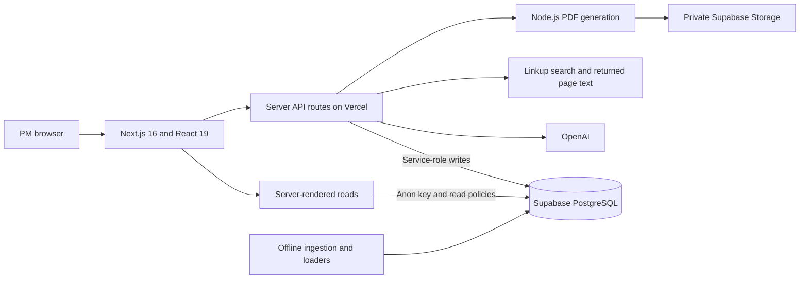
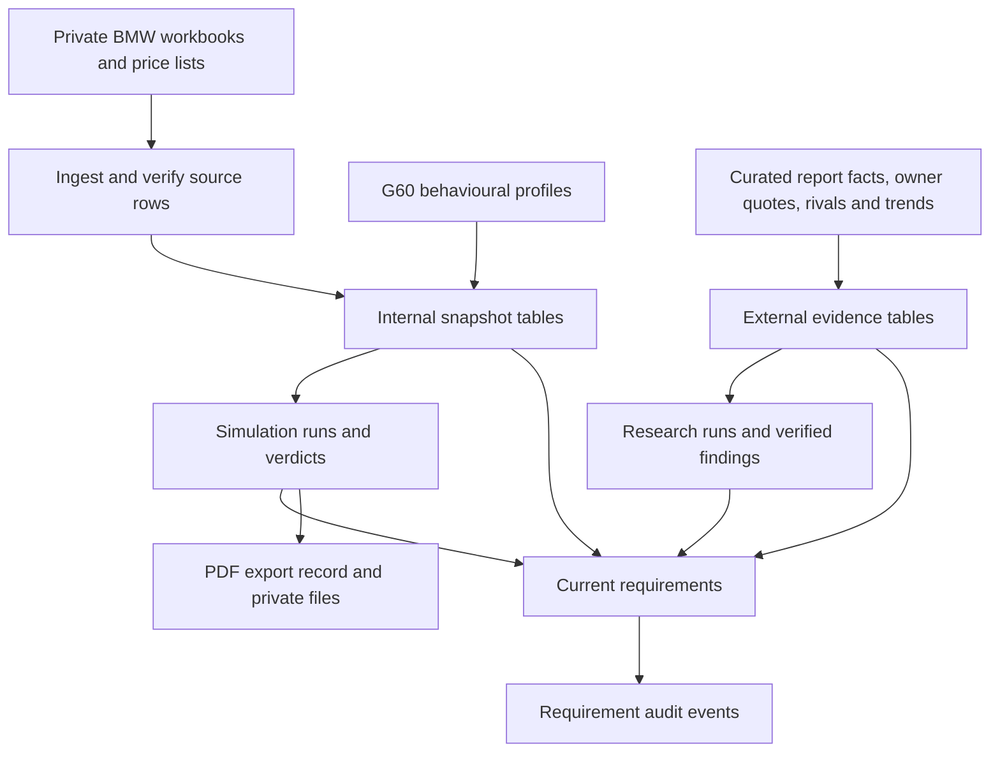
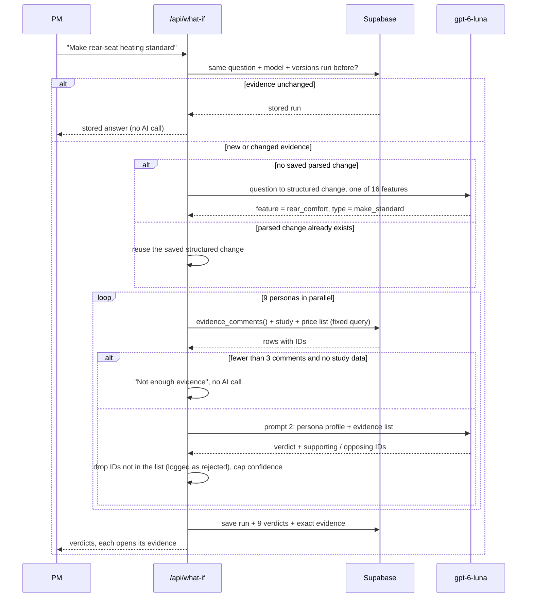
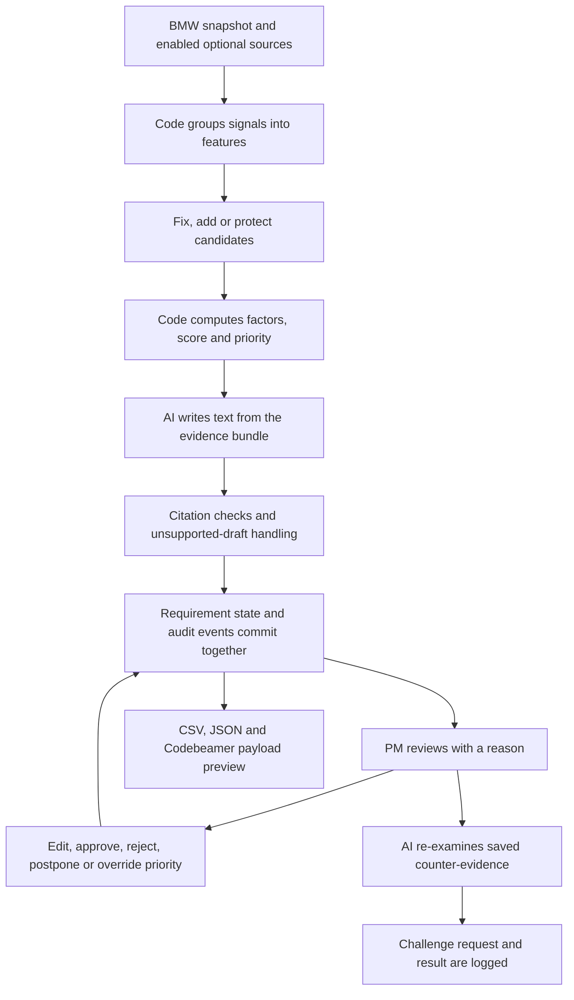
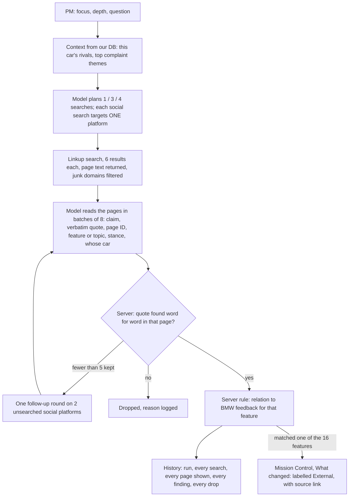

# Backseat · Architecture

How the app is built, where the data comes from, and how the AI stays grounded.
[Live workspace](https://bmw-backseat.vercel.app) · [Usage and setup](README.md)

This overview describes the implemented Next.js application, its data boundaries and its human review workflow.

## 1. System

**Code retrieves and scores. AI interprets and drafts. The product manager decides.**

| Layer | Responsibility | Main implementation |
|---|---|---|
| Interface | Vehicle/market scope, evidence drawers, simulations, research and human review | `app/`, `components/`, `lib/nav.ts`, `lib/scope.ts` |
| Read model | Counts, coverage, studies, public findings and stored results | `lib/data.ts`, `lib/history.ts`, `lib/mission-*`, `lib/requirements/data.ts` |
| AI workflows | Fixed simulation retrieval, bounded web research, grounded requirement text and memo copy | `lib/simulate.ts`, `lib/research.ts`, `lib/requirements/`, `lib/deck/` |
| Persistence | Internal snapshot, generated records, atomic requirement changes and audit events | `supabase/migrations/` |
| Deployment | Next.js on Vercel; functions in Frankfurt (`fra1`) | `vercel.json`, `next.config.ts` |

The browser has no direct database-write permission. Offline loaders and server routes write using the service role. The database/code produces dashboard counts and requirement scores; models do not decide those values. Proposed requirement targets are a separate, explicitly forward-looking output.

Mission Control renders server-fetched evidence in an interactive vehicle-centred view: topic drawers, market circles, public owner voices and a scoped open-requirements link. Its car imagery and development dates are labelled illustrations. Vehicle/market selection is encoded in `?v=...&m=...`; the global market-comparison panel and vehicle-wide research context explicitly retain their wider scope.

## 2. Data and provenance

| Record group | Tables | Meaning |
|---|---|---|
| BMW feedback | `feedback_comment`, `feedback_label` | One comment record plus its taxonomy labels; source row, country and engine retained |
| Study, equipment and sales | `study_metric`, `option_item`, `vehicle_variant`, `sales_volume` | Supplied values with original cell/page references; forecasts distinguished from observed sales |
| Behavioural profiles | `persona`, `persona_evidence` | Nine G60 profiles; illustrative identities are not inferred demographics |
| Curated public evidence | `external_source`, `external_finding`, `search_trend` | Sources, quoted findings, competitor cells, report facts and trends |
| Simulation | `simulation_run`, `simulation_verdict` | Parsed change, method versions, evidence fingerprint, segment reactions and saved evidence |
| Research | `research_run`, `research_finding` | Investigation context, searches, pages, retained/dropped findings and source links |
| Requirements | `requirement_run`, `requirement`, `requirement_event` | Run inputs and CSV snapshot, current requirement state, append-only change history |
| PDF export | `deck_export`, private `decks` bucket | Export status, validated copy, optional image and downloadable PDF |

The BMW snapshot is not modified by app workflows. Simulations and research add records; requirements update in place while keeping their change history. Export status records also change as generation completes. These are distinct persistence models, not a blanket “everything is append-only” claim.

Feedback points to an Excel row, studies to workbook cells, equipment to PDF pages, and public findings to source URLs/report pages. Loader inputs and raw collection responses are local, gitignored files. Settings reads current row counts rather than hard-coding growing public/generated totals.

## 3. What-If: how a simulation runs (current)

**Feature map** (`lib/features.ts`): 16 features, each linked to BMW feedback categories, a keyword pattern, survey questions and price-list option codes. It decides which evidence a persona sees.

**Persona scope** (`lib/simulate.ts`): which countries and engine types each persona stands for, taken from the persona files' market and cohort fields.

## 4. Grounding and repeatability

| Workflow | Evidence boundary | Validation and persistence |
|---|---|---|
| What-If | Code selects BMW comments, study values and equipment via the feature map and fixed persona scope | Citation IDs checked, confidence capped, thin evidence withheld; exact evidence and versions saved |
| Research | Linkup supplies page text; the model cannot browse arbitrary pages itself | Quotes checked against returned text; rejected findings and reasons retained |
| Requirements | Code builds each candidate's evidence bundle from the enabled sources | Supporting/opposing IDs and rationale references checked against that bundle; invalid IDs dropped; unsupported drafts withheld |
| PDF copy | A payload constructed from the stored simulation, not a fresh investigation | Numbers and citation IDs checked; one correction retry, then deterministic fallback copy |

What-If's reuse key includes normalized question, vehicle, model, prompt version and feature-map version; the evidence fingerprint is recomputed before returning a cached run. Research performs fresh searches on each new run. Requirements reuse stable IDs and deterministic scoring rules, but AI text may change on a rerun and those changes are audited. Repeatability is not a claim that an unconstrained model always returns identical prose.

The feature map (`lib/features.ts`) defines 16 feature groups. It is an explicit, AI-drafted taxonomy mapping, not a learned or team-certified customer model. What-If uses internal evidence only; public evidence is available to Mission Control, Research and Requirements.

## 5. Requirements: code-scored, AI-drafted, PM-decided

Code: `lib/requirements/`, `app/api/requirements/`, `app/requirements/`, `components/requirements/`. Method versions: `score-v1`, `req-draft-v1`.

Candidates are selected from unique-comment signals: a pain/want candidate needs at least eight complaints plus wishes; sufficiently dominant praise produces a protect candidate. The fix/add split and thresholds live in `lib/requirements/config.ts`.

| Factor | Default weight | Calculated from |
|---|---|---|
| Customer voice | 30 | Feature complaint/wish or praise counts, relative to the most-discussed feature |
| Customer study | 20 | Matching study values compared with the best BMW sibling in the same market/study |
| Market reach | 15 | 2025 sales share of markets where feedback or study signals exist |
| Rival offer | 15 | Known feature availability in curated rival tables |
| Outside voices agree | 12 | Outside channel groups aligned with the internal signal |
| Segment reaction | 8 | Latest relevant G60 What-If; explicitly simulated and excluded where inapplicable |

The score is the weighted average of applicable factors, scaled to 0-100. Excluded factors have no weight. P1 starts at 60, P2 at 40, and P3 is below 40. Evidence grades A-D are computed separately from comment volume, study support and outside corroboration. The interface exposes factors and sources rather than treating the score as an AI recommendation to obey.

- **Source priority:** internal BMW data is always included. Optional curated public data, saved Research findings and G60 What-If results follow it. Uploaded CSV is lowest-tier, unverified context and contributes no score.
- **Upload boundary:** 300 rows, 500 KB; matched excerpts are given to drafting and the normalized rows are snapshotted in `requirement_run.csv_rows`. No import into BMW tables.
- **Human decisions:** proposed, in review, approved, rejected or postponed. Every PM action needs a reason. Priority overrides are separate from calculated priority; human-edited wording and status survive regeneration.
- **Challenge boundary:** the model re-examines the requirement's saved evidence; it does not launch a fresh web investigation or change the PM's decision.
- **Audit boundary:** `save_requirement_change` commits state and events in one database transaction. Optimistic versions reject stale edits. Stable codes identify the same vehicle/feature/kind across runs; before/after changes record actor, time and rationale.
- **History location:** simulation/research runs appear on `/history`; requirement decisions are read from the audit trail on each requirement detail page.

## 6. Rendering, sharing and workspace boundaries

CSV/JSON exports are generated in the browser from the requirement records supplied to the page. They preserve decision status; CSV additionally neutralizes formula-shaped text before spreadsheet export. A PM can download drafts as well as approvals.

Codebeamer builds one tracker-item body for `POST /api/v3/trackers/{trackerId}/items`. It is a preview, not a connected integration: no URL/token is accepted for sending, no HTTP request is made, and tracker-specific field IDs are not invented. Approved-only is the preview's default filter, not an authentication guarantee.

Long JSON previews are constrained inside their dialog. Markdown diagrams in this document use fenced `mermaid` blocks with quoted labels and edge text; the diagrams explain the system, not generated evidence or measured performance.

The application is a shared, anonymous prototype. Display names are not verified identities, and read access exposes the workspace's records, including saved upload context. Private Storage does not make the public app authenticated. Do not treat it as a production access-control boundary for confidential customer data.

## 7. Research Agent (live)

Code: `lib/research.ts`, `app/api/research/route.ts`, `components/research-client.tsx`. Tables: `research_run`, `research_finding`. Prompt version `research-v4`.

The model does not control a browser. Linkup handles search and returns page text; the model reads only that supplied text. Quote matching checks the returned text, not whether a source is truthful or representative.

Rules:

1. Every run and every finding is saved to History, whether or not it maps to a feature.
2. Web findings never change dashboard numbers. Counts come from BMW data only. Findings appear beside them, labelled External, with source link.
3. Findings are mapped with the same 16-feature map as What-If, so a finding about rear-seat heating lands next to the rear-comfort evidence.
4. A quote that is not in the page Linkup returned is dropped and logged.
5. Linkup calls per run are capped by depth (1, 3 or 4, plus at most 2 follow-up searches when fewer than 5 findings survive; never on Quick), 6 results each, at most 24 pages in the first read and 12 more in the follow-up. A run keeps at most 12 findings, owners' own words first. Under 5, the page says so; nothing is padded.
6. The relation label is a fixed rule, not the model: BMW's own comment counts for the feature are stored with each finding.
   - Fewer than 5 BMW comments on the feature: **new signal**.
   - Facts without opinion (specs, prices, a rival offering a feature, any official spec page): **context**.
   - Opinions: **agrees** if at least 20% of BMW's comments on that feature point the same way (praise for praise; complaints + wishes for complaints), else **contradicts**.

Sources, and why: Linkup returns the page text, so every quote can be checked. OpenAI's own web search returns citations but not the page text, so quotes could not be verified; not used. Reddit is reached through Linkup (`includeDomains` per platform); the Hermes Reddit skill is for offline collection only (about 1 request per minute without credentials).

Mixed sources (`research-v4`): every search targets either "web" (press, reviews, maker pages, studies) or ONE social platform group: Reddit, owner forums (Bimmerpost, Bimmerfest, MBWorld, Audizine, motor-talk), X, YouTube/TikTok, Facebook, Chinese car communities (Autohome, Dongchedi); list in `lib/channels.ts`, probed with Linkup. One platform per search stops Reddit from crowding out the rest. Instagram, Weibo and Xiaohongshu are left out because Linkup returns almost no text from them. Standard and deep runs always mix at least one web and one social search; the "Owner voices" focus is social only. Focus (Open question, Owner voices, Competitors, Press and reviews, Market trends) only steers the planner. The planner gets this car's rival list from our comparison table, so "top three competitors" means the first three rivals there. Findings that match none of the 16 features carry a short topic label instead. Each finding records whose car it is about (the BMW, a named rival, or the market); only claims about the BMW get the agrees / contradicts label. The channel tag (Reddit, X, Owner forum, Press...) is read from the URL, not from the model.

## 8. PDF decision memo (live)

Code: `lib/deck/*`, `app/api/deck/route.ts`, `app/api/deck/file/route.ts`, `components/deck-button.tsx`. Table `deck_export`, private storage bucket `decks`. Design: `docs/DECK-EXPORT-SPEC.md` (partner's spec), simplified to synchronous generation.

1. **Payload (no AI):** the stored What-If run becomes a fixed payload: verdict counts, per-segment rows, every cited item with its verbatim text and source line. It is the only source of numbers and quotes in the PDF.
2. **Copy (gpt-6-luna):** title, 3 bullets, takeaway. A validator rejects any number not in the payload and any unknown evidence ID; one correction retry, then a plain fallback built from the counts. `copy_source` records which one shipped.
3. **Cover (gpt-image-2.5-flare):** one illustration, with a fixed footer forbidding text, logos, badges and faces. Any failure means no cover; the PDF still renders.
4. **PDF (@react-pdf/renderer):** cover, segment board, evidence, assumptions and gaps, full citation appendix; run ID, model and prompt version on every page.
5. Stored once per run; the What-If page offers Export or Download, History links every ready PDF.

`@react-pdf/renderer` is listed in `serverExternalPackages` so its fonts and Yoga assets remain available to the Node.js function. The renderer builds the PDF from the fixed payload; an optional cover failure does not block the document. The cover is illustrative, not evidence. The file is served through `/api/deck/file?run=<id>` from the private `decks` bucket.

## 9. Settings, credentials and environment

Settings exposes a display name, masked personal OpenAI key input, Requirements model selection, live database counts, provider status and read-only method constraints. Only OpenAI personal keys are wired; other AI/search-provider entries describe availability, not active adapters. Linkup uses the server's configured key.

| Credential | Scope | Handling |
|---|---|---|
| `NEXT_PUBLIC_SUPABASE_URL` | Public project endpoint | Used by read clients and server clients |
| `NEXT_PUBLIC_SUPABASE_ANON_KEY` | Public read credential | Database permissions and row-level policies deny browser writes |
| `SUPABASE_SERVICE_ROLE_KEY` | Server-side database/storage writes | Never placed in a public-prefixed variable or browser setting |
| `OPENAI_API_KEY` | Team AI fallback | Server environment; used by What-If, Research, PDF generation and Requirements without a personal key |
| `LINKUP_API_KEY` | Web search provider | Server environment only |
| Personal OpenAI key/model | Requirements drafting and challenge | `backseat.ai` in browser local storage; sent as `x-openai-key` / `x-openai-model`, never stored in Supabase |
| PM display name | Requirement run/action attribution | `backseat.pm_name` locally; recorded with the action as “not signed in” |

Local development reads an untracked `.env.local`. Vercel has its own environment configuration; Settings cannot change those shared secrets or trigger their deployment. Saving a personal Requirements key affects the next request only. Removing it restores the server fallback.

The team's `scripts/push-env.sh` (`npm run env:push`) reads a trusted local `.env.local` and synchronizes OpenAI and Linkup keys to the linked Vercel project. Production/preview values are sensitive; development uses the CLI's development setting. Supabase variables are configured separately. Redeploy after changing server environment values. Supabase CLI authentication/database-password configuration is separate from runtime credentials; `SUPABASE_DB_PASSWORD` is used for linked migration commands, not by the web app.

Local storage is browser storage, not an encrypted vault. Use a personal key only on a trusted device/origin and remove it when sharing that browser. No environment values or real keys belong in repository documentation.

## 10. API boundaries and operation

| Route | Purpose | Execution/budget boundary |
|---|---|---|
| `/api/what-if` | Create/reuse a simulation; GET reopens a stored run | 60-second function; G60 only; question has at least five words and at most 500 characters |
| `/api/research` | Run a bounded investigation; GET reopens a run | 300-second function; search/page caps described in section 7 |
| `/api/requirements/generate` | Read signals, score, draft and persist requirements | 300-second function; one active run per car line for both own/team keys; team budget of six runs per car line per ten minutes |
| `/api/requirements/[id]` | PM status/edit/priority action or AI challenge | 120-second function; reasons required; team budget of twelve challenges per workspace per ten minutes |
| `/api/settings/test-key` | Validate an entered OpenAI key without storing it | 30-second function; thirty requests per minute per running server instance, not a global distributed limit |
| `/api/deck` | Generate/reuse the stored-run PDF; GET returns export status | 120-second Node.js function; ready exports are reused and recent in-flight exports are not duplicated |
| `/api/deck/file` | Download an existing PDF | File retrieval, not a new AI generation |

Requirement budgets are reserved in PostgreSQL under advisory transaction locks before a paid request starts. Challenge attempts count even if the model call fails. The schema also keeps requirement-state/audit changes atomic and exposes these write functions only to the service role.

What-If, Research and PDF generation do not have equivalent workspace-level paid-call rate limits. Their input, search and reuse guards are not a global spending cap. All public generation routes can spend team-provider credits; the anonymous prototype should not be described as a hardened production service.

Pushes to `main` deploy the production app on Vercel. Preview deployments can be produced for other branches; they do not imply an isolated database. Functions use Frankfurt (`fra1`); the deployed runtime is Node.js 24. The browser is not running the development Hermes/Claude harness, and Python is not part of the deployed application.

For clone/setup commands and the private-data prerequisite, see [README.md](README.md). For prompt design, see [docs/PROMPTS.md](docs/PROMPTS.md). This document describes implemented behavior, not a roadmap or a claim of measured model accuracy.
