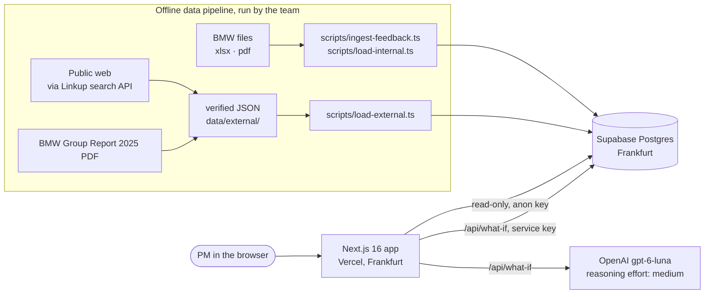
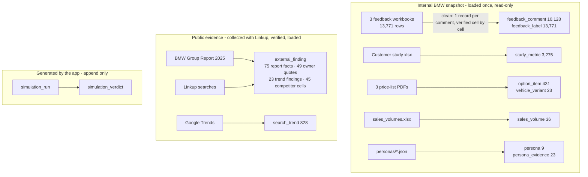
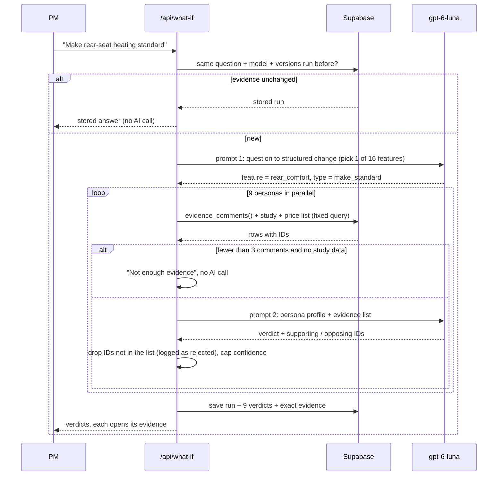
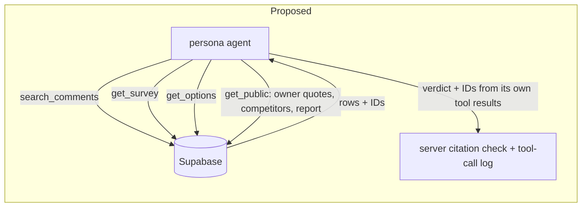
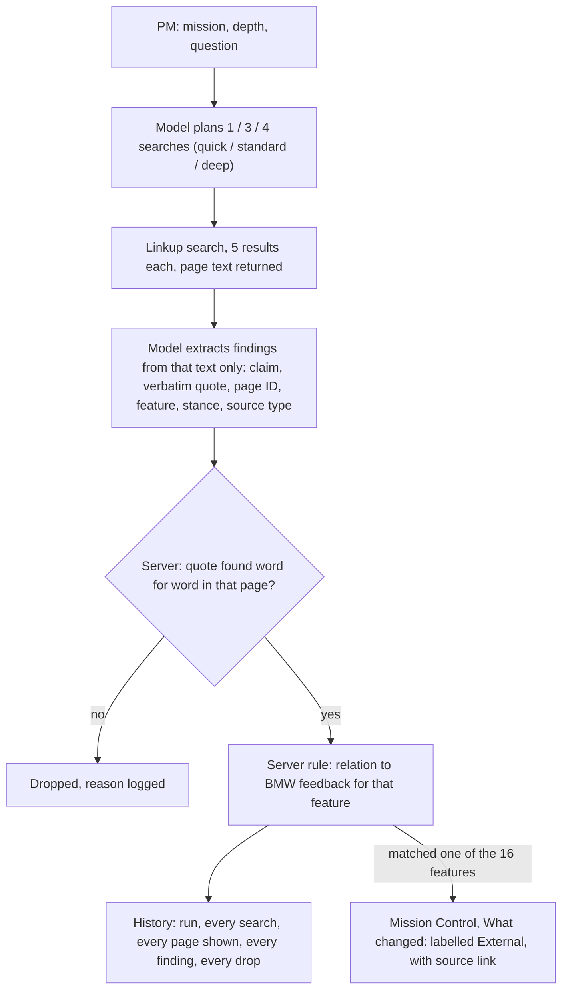

# Backseat · Architecture

How the app is built, where the data comes from, and how the AI stays grounded.
Live: https://bmw-backseat.vercel.app · status as of 2026-10-11.

## 1. System

- Every push to `main` deploys to production. There is no separate staging.
- The browser only ever reads. Writes happen in two places: the loader scripts (run by the team) and `/api/what-if` (saves each run).
- The database does all counting. The AI never produces a number shown on a dashboard.

## 2. Data (ETL)

Every row points back to its source: feedback to its Excel row, survey values to their sheet cell, options to the PDF page, public findings to a URL or report page with a verbatim quote. Raw Linkup responses are kept in `data/external/raw/` (local, not in git) for audit.

## 3. What-If: how a simulation runs (current)

**Feature map** (`lib/features.ts`): 16 features, each linked to BMW feedback categories, a keyword pattern, survey questions and price-list option codes. It decides which evidence a persona sees.

**Persona scope** (`lib/simulate.ts`): which countries and engine types each persona stands for, taken from the persona files' market and cohort fields.

## 4. Grounding rules

1. The database selects the evidence, the same way every time for the same question.
2. The model sees only that evidence. Each item has an ID.
3. The model must cite IDs. The server drops any ID that was not given and stores it as rejected. No valid citation means no verdict.
4. Too little evidence means "Not enough evidence" without asking the model.
5. Same question + same evidence returns the stored answer. Repeatability comes from this cache, not from the model.
6. Every run is stored with the model, prompt version, feature-map version and an evidence fingerprint.

## 5. Current vs proposed (agentic search)

Today the model does not search. Code picks the evidence and the model reads it. The proposal gives the model read-only search tools over the same database.

| | Current: fixed retrieval | Proposed: agentic search |
|---|---|---|
| Who picks the evidence | Code, via the feature map | The model, by calling search tools (max ~5 steps) |
| Same question, same evidence | Yes, always | No; the cache makes a repeated question identical |
| Finds evidence the map misses | No | Yes |
| Uses public data (owner quotes, competitors, report) | No | Yes |
| Speed and cost per question | ~20 s, up to 10 model calls | ~3-5x more calls |
| Audit trail | Evidence list per persona | Every tool call and its rows, per persona |
| Risk | Thin evidence when the map is incomplete | Less predictable; needs a step and cost cap |

## 6. Known limits

- Prompts in `lib/simulate.ts` are first drafts (`whatif-v2`); a reviewed rewrite is pending.
- The feature map and persona scope were drafted by Claude and are not yet reviewed by the team.
- `/api/what-if` has no rate limit yet (on the backlog).
- Personas exist for the 5 Series (G60) only.
- Public data shows on Mission Control (Outside view) and Research (competitor table); it is not used by What-If verdicts.
- `/api/research` has no rate limit yet either (backlog).

## 7. Research Agent (live)

Code: `lib/research.ts`, `app/api/research/route.ts`, `components/research-client.tsx`. Tables: `research_run`, `research_finding`. Prompt version `research-v3`.

The model never browses. Linkup searches the web and returns page text; the model reads only that text. No browser, no scraping.

Rules:

1. Every run and every finding is saved to History, whether or not it maps to a feature.
2. Web findings never change dashboard numbers. Counts come from BMW data only. Findings appear beside them, labelled External, with source link.
3. Findings are mapped with the same 16-feature map as What-If, so a finding about rear-seat heating lands next to the rear-comfort evidence.
4. A quote that is not in the page Linkup returned is dropped and logged.
5. Linkup calls per run are capped by depth (1, 3 or 4), 5 results each, at most 15 pages shown to the model.
6. The relation label is a fixed rule, not the model: BMW's own comment counts for the feature are stored with each finding.
   - Fewer than 5 BMW comments on the feature: **new signal**.
   - Facts without opinion (specs, prices, a rival offering a feature, any official spec page): **context**.
   - Opinions: **agrees** if at least 20% of BMW's comments on that feature point the same way (praise for praise; complaints + wishes for complaints), else **contradicts**.

Sources, and why: Linkup returns the page text, so every quote can be checked. OpenAI's own web search returns citations but not the page text, so quotes could not be verified; not used. Reddit is reached through Linkup (`includeDomains` for the owner mission); the Hermes Reddit skill is for offline collection only (about 1 request per minute without credentials).

Social first (`research-v3`): every search is tagged social or web. Social searches run only on Reddit, X, Facebook, TikTok, YouTube, owner forums (Bimmerpost, Bimmerfest, MBWorld, Audizine) and Chinese car communities (Autohome, Dongchedi); list in `lib/channels.ts`, probed with Linkup. Instagram, Weibo and Xiaohongshu are left out because Linkup returns almost no text from them. Standard and deep runs always include at least one social search (except Trends); "Social and owner voices" is social only. Each finding records whose car it is about (the BMW, a named rival, or the market); only claims about the BMW get the agrees / contradicts label. The channel tag (Reddit, X, Owner forum, Press...) is read from the URL, not from the model.
